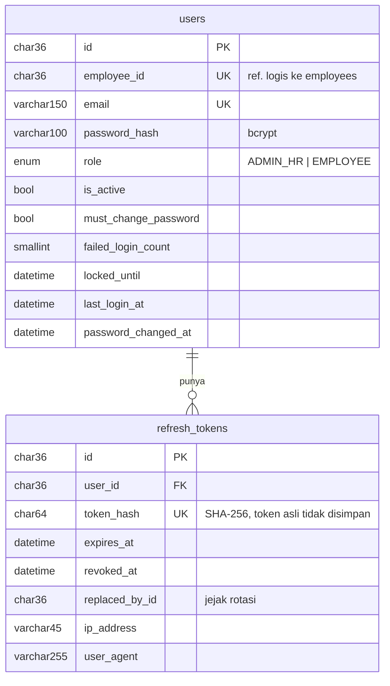
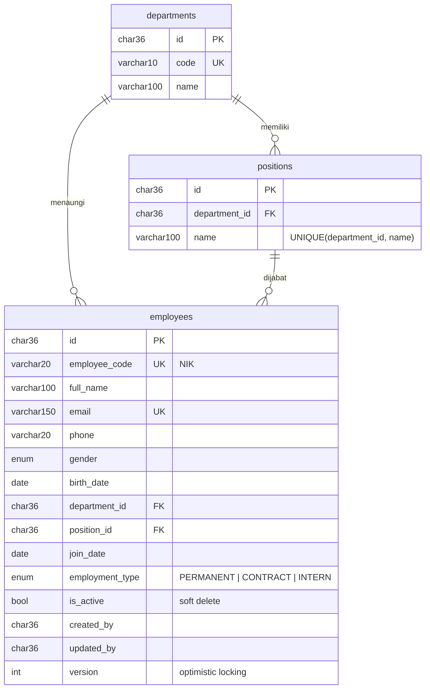
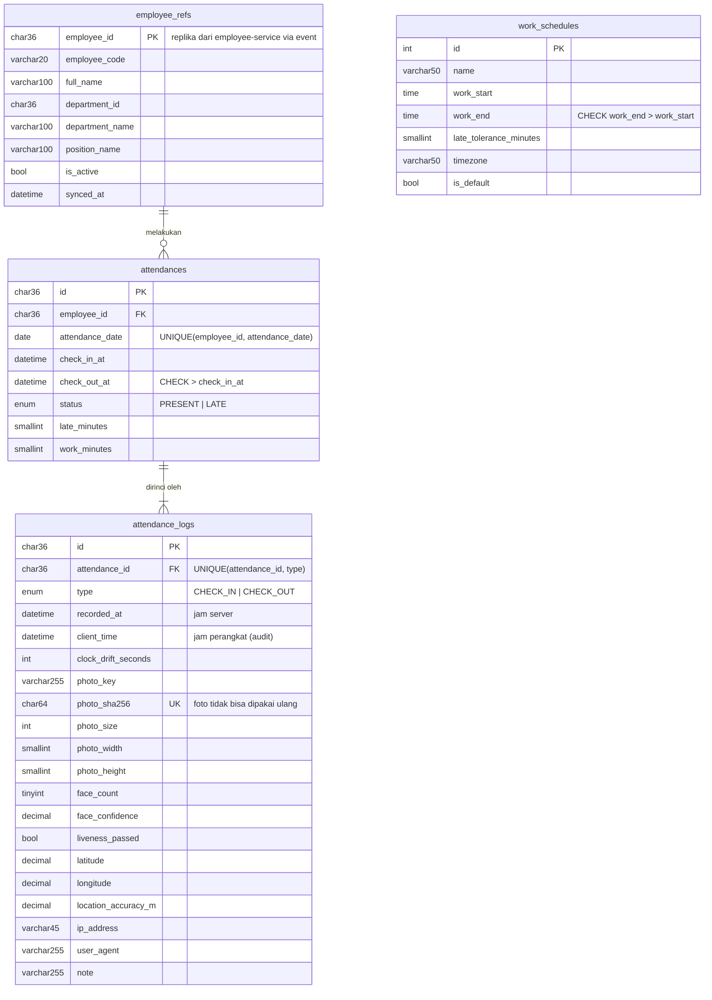

# Struktur Database

Satu instance MySQL 8.4, **tiga database terpisah** (database-per-service). Setiap service punya user MySQL sendiri yang hanya bisa mengakses database miliknya (`docker/mysql/init.sql`). Relasi lintas service (mis. `users.employee_id` → `employees.id`) adalah **referensi logis tanpa foreign key fisik**; konsistensinya dijaga lewat saga dan event.

Semua primary key `CHAR(36)` UUID (kecuali `work_schedules`). Semua `DATETIME` disimpan dalam UTC; `attendance_date` adalah tanggal kalender **Asia/Jakarta**. Skema dibuat lewat migration TypeORM yang ditulis manual (`apps/*/src/migrations`), `synchronize` dimatikan.

## auth-service → `hris_auth_db`

## employee-service → `hris_employee_db`

## attendance-service → `hris_attendance_db`

## Constraint yang menjaga aturan bisnis di level database

| Constraint | Aturan |
|---|---|
| `UQ_attendances_employee_date` | Satu check-in per karyawan per hari — pengaman terakhir dari race condition (dua request bersamaan) |
| `UQ_attendance_logs_attendance_type` | Satu check-in dan satu check-out per absensi |
| `UQ_attendance_logs_photo_sha256` | File foto yang sama tidak bisa dipakai absen dua kali |
| `CHK_attendances_checkout_after_checkin` | Jam check-out harus setelah check-in |
| `FK_attendances_employee_ref` (RESTRICT) | Replika karyawan yang sudah punya absensi tidak bisa terhapus |
| `UQ_employees_employee_code`, `UQ_employees_email` | NIK & email unik |
| `UQ_positions_department_name` + validasi service | Jabatan selalu milik departemen yang dipilih |
| `employees.version` | Optimistic locking: `UPDATE ... WHERE id = ? AND version = ?` |
| `UQ_users_email`, `UQ_users_employee_id` | Satu akun login per karyawan |
